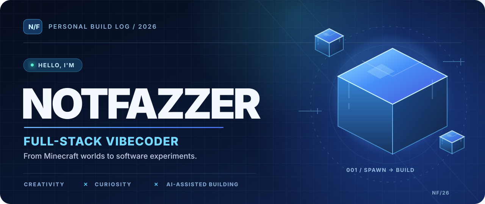
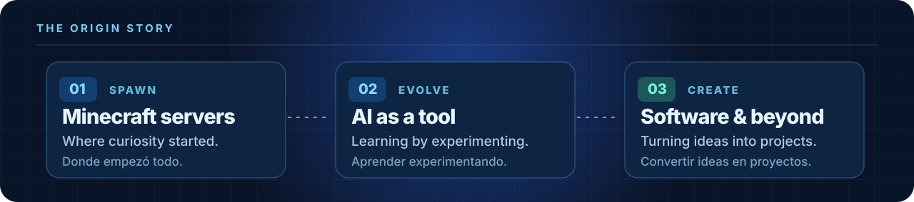
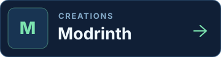
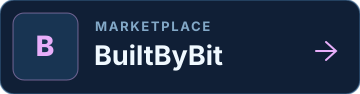
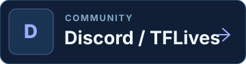
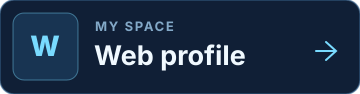
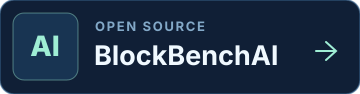
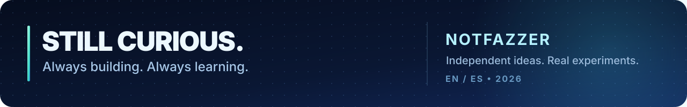

<!--
  NOTFAZZER / PERSONAL PROFILE
  Designed as a self-contained profile: all visuals are local SVGs.
  English and Spanish are intentionally first-class; there are no invented skill levels.
-->

 

**[THE ORIGIN](#01--the-origin--el-origen)** &nbsp;·&nbsp; **[FEATURED WORK](#02--featured-work--proyecto-destacado)** &nbsp;·&nbsp; **[FIND ME](#03--find-me--encuéntrame)**

 

## 01 / THE ORIGIN · EL ORIGEN

**EN** &nbsp; I started with basic Minecraft servers. Curiosity kept pulling me further: from configurations and communities to tools, interfaces, and software projects. AI became part of how I explore and learn. I'm not pretending to have it all figured out — I just really enjoy making ideas work.

**ES** &nbsp; Empecé creando servidores básicos de Minecraft. La curiosidad me llevó más lejos: de configuraciones y comunidades a herramientas, interfaces y proyectos de software. La IA se convirtió en parte de mi forma de explorar y aprender. No pretendo saberlo todo; simplemente disfruto hacer realidad las ideas.

 

 

> **Full-stack vibecoder.** I build, break, learn, improve, and repeat.
>
> **Vibecoder full-stack.** Creo, pruebo, aprendo, mejoro y vuelvo a empezar.

 

## 02 / FEATURED WORK · PROYECTO DESTACADO

**[BlockBenchAI](https://github.com/jonathanthxd/BlockBenchAI)** is an experimental, open-source AI copilot for Blockbench. Its goal is to make 3D creation more approachable through a dockable assistant, editable cube-based geometry, and procedural pixel textures. It's still evolving — and that's part of the fun.

**[BlockBenchAI](https://github.com/jonathanthxd/BlockBenchAI)** es un copiloto experimental y de código abierto para Blockbench. Busca facilitar la creación 3D con un asistente integrado, geometría editable basada en cubos y texturas pixeladas generadas mediante procedimientos. Sigue evolucionando, y eso es parte de la aventura.

**[Explore the source →](https://github.com/jonathanthxd/BlockBenchAI)** &nbsp; **[Read the Spanish guide →](https://github.com/jonathanthxd/BlockBenchAI/blob/main/docs/README.es.md)**

More projects will join this space as I build and refine them. / Iré añadiendo más proyectos conforme los desarrolle y mejore.

 
 

## 03 / FIND ME · ENCUÉNTRAME

 

**Discord:** `jonathan.py` &nbsp; · &nbsp; **Community / Comunidad:** [discord.gg/tflives](https://discord.gg/tflives)

**What I do / Qué hago:** Build experiments, learn with AI, and help grow the TFLives ecosystem. / Desarrollo experimentos, aprendo con IA y ayudo a hacer crecer el ecosistema TFLives.

 

Designed for the curious. Built with intention. · Hecho con curiosidad y ganas de aprender.

